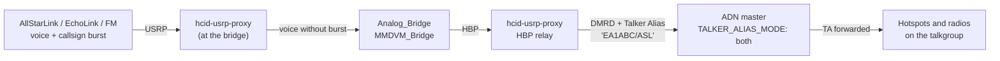

# Analog bridges: who is talking? (Ham CallerID)

ADN links talkgroups to analog systems through bridges: an AllStarLink node with DVSwitch
(Analog_Bridge + MMDVM_Bridge), EchoLink conferences reached through AllStarLink, FM repeaters.
Analog audio carries **no callsign**, so today every call that enters ADN through such a bridge
shows up with the **bridge's own DMR ID**. Listeners, the monitor and the last-heard lists cannot
tell who is speaking, and if the bridge uses a person's ID everything looks as if that person
were talking.

[Ham CallerID](https://github.com/pyopower/ham-callerid) (open specification + MIT code) closes
that gap **without any change to the ADN server**: it identifies the talker on the analog side
and delivers the callsign through the standard DMR mechanism ADN already supports,
the [Talker Alias](talker-alias.md).



## How it works

1. **On the analog side** the talker's client sends a short data burst with the callsign at
   key-up and release (~220 ms, AFSK 1200 baud with Golay FEC). Mobile ASL Client (Android) does
   it out of the box; the format is open and has Python, Kotlin and single-file C
   implementations with conformance vectors.
2. **At the bridge**, `hcid-usrp-proxy` sits between `chan_usrp` and Analog_Bridge. It finds the
   burst, removes it from the audio and writes the callsign into the **Talker Alias inside the
   voice frames** (embedded LC, FLCO 4–7, alternating with the group LC exactly like a radio).
   No burst? It asks app_rpt over AMI which link is keyed and uses the **EchoLink callsign**
   (validated by EchoLink), the IAX client's callsign or the source **AllStar node number**.
3. **In ADN** nothing changes: with `TALKER_ALIAS_MODE: both` (the default) the master prefers
   the source's own TA and forwards it to the peers of the talkgroup.
4. **Back towards analog**, the proxy turns the DMR caller's ID/callsign into a burst at the start
   and end of the audio, so AllStarLink users with a decoder also see who is talking from DMR.

## Advantages for ADN

| | Bridge today | With Ham CallerID |
|---|---|---|
| Talker on the talkgroup | bridge ID only | callsign + origin in the Talker Alias (`EA1ABC/ASL`, `EA2XYZ/EL`, `ASL 12345`) |
| EchoLink stations | anonymous | callsign validated by EchoLink |
| Calls from DMR heard on AllStarLink | anonymous | callsign burst, shown by the client |
| Changes on the ADN server | — | **none** (standard Talker Alias, `both` mode) |
| Changes on ASL / DVSwitch | — | none: a separate process; configuration is only port changes |
| Radios / hotspots | — | any device that shows TA (MMDVMHost logs it too) |

- **Honest identification.** The burst is self-declared, as analog itself is, so the bridge keeps
  its own DMR ID and the alias always carries the origin (`/ASL`, `/EL`). Nobody's DMR ID is
  used on their behalf. Use a bridge or system ID as `gatewayDmrId`, never a person's.
- **Works with today's bridges.** The proxy only moves DVSwitch ports; rollback is restoring two
  `.ini` files.
- **Robust where it matters.** The burst survives µ-law/IAX, FM paths with noise, Opus 16 kbps
  and packet loss. GSM (EchoLink audio) cannot carry FSK, which is why EchoLink callsigns come
  from EchoLink itself.

## Tested in production

ADN 2131 (v2.7.0) ⇄ AllStarLink 60596 ⇄ TG 213: the bridge recognised the callsign burst
0.4 s after the start of the call and inserted `C31AG/ASL` into the voice; a capture of what the
master forwards to another system on TG 213 decodes the same alias. DMR calls arriving on
AllStarLink carry the burst at both ends.

## Setup

Install guide, options and rollback: **[ham-callerid/docs/BRIDGE.md](https://github.com/pyopower/ham-callerid/blob/main/docs/BRIDGE.md)**.

Server side, check that Talker Alias is enabled (the defaults are fine):

```yaml
GLOBAL:
  TALKER_ALIAS: true
  TALKER_ALIAS_MODE: both
```

## Limitations

| Topic | Status |
|---|---|
| Monitor dashboard / last heard | Show the bridge ID (they use DB aliases, not the live TA — see [Talker Alias](talker-alias.md#limitations-and-follow-up-work)). |
| OpenBridge legs | TA is not carried on OBP today, so systems reached only through OpenBridge do not get the alias. |
| `DMRA` packets | The proxy sends the alias inside the voice frames; `DMRA` is optional (`--dmra`) because HBlink masters reject it. |
