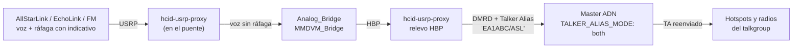

# Puentes analógicos: ¿quién está hablando? (Ham CallerID)

ADN enlaza talkgroups con sistemas analógicos mediante puentes: un nodo AllStarLink con DVSwitch
(Analog_Bridge + MMDVM_Bridge), conferencias EchoLink alcanzadas a través de AllStarLink,
repetidores FM. El audio analógico **no lleva indicativo**, así que hoy toda llamada que entra en
ADN por uno de esos puentes aparece con el **ID DMR del propio puente**. Ni quien escucha, ni el
monitor, ni las listas de últimos oídos saben quién habla; y si el puente usa el ID de una persona,
todo parece dicho por esa persona.

[Ham CallerID](https://github.com/pyopower/ham-callerid) (especificación abierta + código MIT)
resuelve esa carencia **sin ningún cambio en el servidor ADN**: identifica a quien habla en el
lado analógico y entrega el indicativo con el mecanismo DMR estándar que ADN ya admite,
el [Talker Alias](talker-alias.md).



## Cómo funciona

1. **En el lado analógico** el cliente de quien habla emite una ráfaga corta de datos con el
   indicativo al pulsar y al soltar (~220 ms, AFSK 1200 baudios con corrección de errores Golay).
   Mobile ASL Client (Android) lo hace de serie; el formato es abierto y tiene implementaciones en
   Python, Kotlin y C (un solo fichero) con vectores de conformidad.
2. **En el puente**, `hcid-usrp-proxy` se coloca entre `chan_usrp` y Analog_Bridge. Encuentra la
   ráfaga, la quita del audio y escribe el indicativo en el **Talker Alias dentro de las tramas de
   voz** (LC embebido, FLCO 4–7, alternando con el LC de grupo igual que una radio).
   ¿Sin ráfaga? Pregunta a app_rpt por AMI qué enlace transmite y usa el **indicativo EchoLink**
   (validado por EchoLink), el del cliente IAX o el **número del nodo AllStar** de origen.
3. **En ADN** no cambia nada: con `TALKER_ALIAS_MODE: both` (el valor por defecto) el master prefiere
   el TA de la fuente y lo reenvía a los peers del talkgroup.
4. **De vuelta hacia lo analógico**, el intermediario convierte el ID/indicativo de quien llama desde
   DMR en una ráfaga al principio y al final del audio, para que los usuarios de AllStarLink con
   decodificador también vean quién habla desde DMR.

## Ventajas para ADN

| | Puente hoy | Con Ham CallerID |
|---|---|---|
| Quién habla en el talkgroup | solo el ID del puente | indicativo + origen en el Talker Alias (`EA1ABC/ASL`, `EA2XYZ/EL`, `ASL 12345`) |
| Estaciones EchoLink | anónimas | indicativo validado por EchoLink |
| Llamadas desde DMR oídas en AllStarLink | anónimas | ráfaga con el indicativo, que muestra el cliente |
| Cambios en el servidor ADN | — | **ninguno** (Talker Alias estándar, modo `both`) |
| Cambios en ASL / DVSwitch | — | ninguno: es un proceso aparte; solo se cambian puertos |
| Radios / hotspots | — | cualquier equipo que muestre TA (MMDVMHost también lo registra) |

- **Identificación honesta.** La ráfaga es declarada, como el propio analógico, así que el puente
  conserva su propio ID DMR y el alias siempre lleva el origen (`/ASL`, `/EL`). No se usa el ID DMR
  de nadie en su nombre. Conviene usar como `gatewayDmrId` un ID de puente o de sistema, nunca el
  de una persona.
- **Funciona con los puentes actuales.** El intermediario solo mueve puertos de DVSwitch; para
  revertir basta con restaurar dos ficheros `.ini`.
- **Robusto donde importa.** La ráfaga sobrevive a µ-law/IAX, caminos FM con ruido, Opus 16 kbps y
  pérdida de paquetes. GSM (el audio de EchoLink) no admite FSK; por eso los indicativos EchoLink
  se toman del propio EchoLink.

## Probado en producción

ADN 2131 (v2.7.0) ⇄ AllStarLink 60596 ⇄ TG 213: el puente reconoció la ráfaga 0,4 s después de
empezar la llamada e insertó `C31AG/ASL` en la voz; una captura de lo que el master reenvía a otro
sistema del TG 213 descodifica el mismo alias. Las llamadas DMR que llegan a AllStarLink llevan la
ráfaga en ambos extremos.

## Instalación

Guía de instalación, opciones y vuelta atrás: **[ham-callerid/docs/BRIDGE.md](https://github.com/pyopower/ham-callerid/blob/main/docs/BRIDGE.md)**.

En el servidor, comprobar que el Talker Alias está activo (los valores por defecto sirven):

```yaml
GLOBAL:
  TALKER_ALIAS: true
  TALKER_ALIAS_MODE: both
```

## Limitaciones

| Tema | Estado |
|---|---|
| Monitor / últimos oídos | Muestran el ID del puente (usan los alias de la base de datos, no el TA en vivo — ver [Talker Alias](talker-alias.md)). |
| Enlaces OpenBridge | Hoy el TA no viaja por OBP, así que los sistemas a los que solo se llega por OpenBridge no reciben el alias. |
| Paquetes `DMRA` | El intermediario envía el alias dentro de la voz; `DMRA` es opcional (`--dmra`) porque los masters HBlink lo rechazan. |
